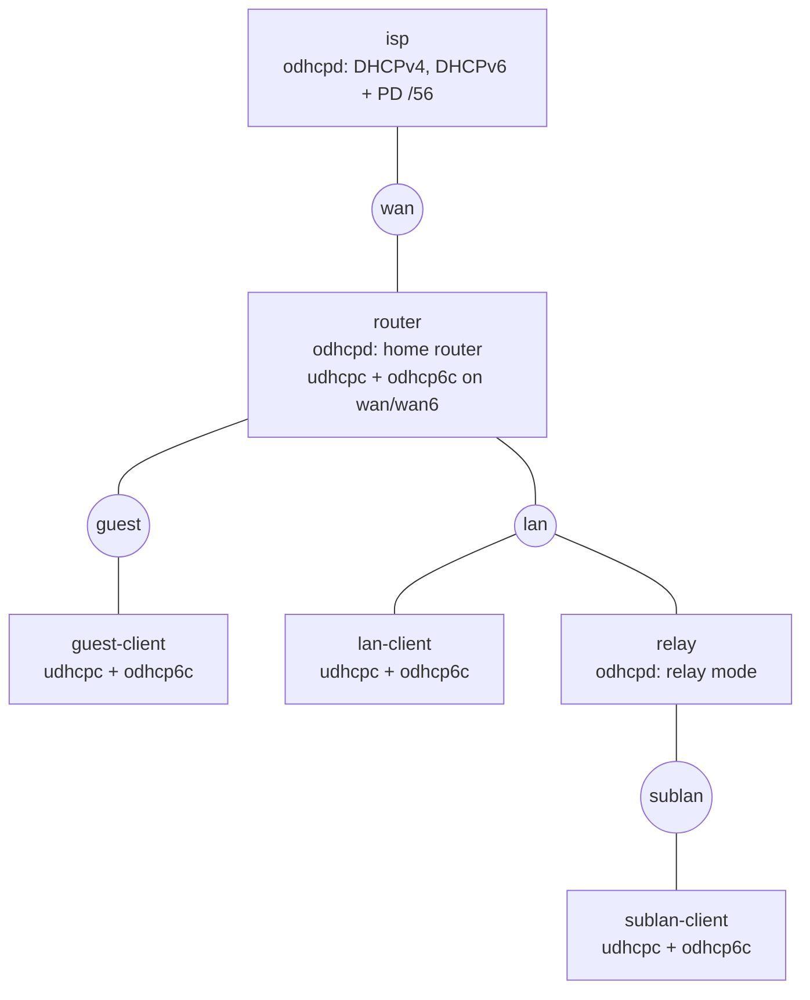

# odhcpd network lab

A complete home network on your own machine, for testing odhcpd by hand and
(later) automatically. It runs in Linux network namespaces inside a user
namespace, so it needs no root privileges, no VMs and no OpenWrt image, and it
builds everything it needs itself.

*Status: under construction. Implemented: the whole network with its odhcpd
nodes and DHCP clients, crafted/malformed packets and the commands below. Not
yet: the automated tests.*

## Topology



Round nodes are networks (a Linux bridge each, which is also where packets can
be captured); the others are nodes, each in its own network namespace.

* **isp**: odhcpd as the ISP's DHCPv4 and DHCPv6 server, delegating a /56 to
  the router.
* **router**: odhcpd as a typical home router, with a `wan`/`wan6` uplink
  (OpenWrt's DHCP clients: busybox `udhcpc` and `odhcp6c`) and the `lan` and
  `guest` networks, each getting a /64 from the delegated /56.
* **relay**: a second odhcpd relaying DHCPv4, DHCPv6, RA and NDP from `lan` to
  `sublan` (transparently: `sublan` shares `lan`'s subnets).
* **guest-client**, **lan-client**, **sublan-client**: DHCPv4/DHCPv6 clients
  (`udhcpc` and `odhcp6c`).

Each odhcpd node has its own ubusd and a minimal stand-in for netifd
(`tests/netifd-stub/`), which provides the interface information odhcpd normally
gets from netifd (`network.interface`, `dump` and update notifications), puts
the interfaces' addresses on their devices and, like netifd's `ip6assign`,
gives interfaces a /64 of the ULA prefix and of delegated prefixes. DHCP client
scripts report their results to it with
`ubus call network.interface update '{"interface": ..., ...}'`.

## Addressing

| Network | IPv4 | IPv6 |
| :------ | :--- | :--- |
| wan | 192.0.2.0/24 | 2001:db8:ff::/64; isp delegates /56s from 2001:db8:100::/40 |
| lan | 192.168.1.0/24 | a /64 of the delegated /56, a /64 of fd00:1::/48 |
| guest | 192.168.2.0/24 | a /64 of the delegated /56, a /64 of fd00:1::/48 |
| sublan | (lan's subnet, relayed) | (lan's /64s, relayed) |

## Crafted and malformed packets

The real clients only send correct packets. `probe` sends hand-made DHCPv6,
DHCPv4 or RS messages from any node and shows the decoded replies; `fuzz` sends
seeded random mutations of valid messages and then checks that every odhcpd is
still running and still answers:

```
tests/lab <node> probe [--dev DEV] dhcp6|dhcp4|rs <step> [<step> ...]
tests/lab <node> fuzz [--dev DEV] dhcp6|dhcp4|rs <count> [seed]
```

Packets are built byte by byte (so any option or length can be wrong) and sent
as raw frames, so the probe doesn't disturb the node's real clients. Each probe
is saved as `lab/run/<name>/<node>/probe-*.pcap`. Steps look like
`sol:rc,na=1`, `req`, `ren`, `conf:na=1/2001:db8::1`, `inf`; flags include
`opt=CODE:HEX` (a raw option), `rawopt=HEX`, `raw=HEX` (the whole message),
`trid=HEX`, `nosid`, `duid=HEX`, `relay` (wrapped in a Relay-Forward) and
`as=client` (the node's real client's identity: its MAC, DUID and IAID, and its
current leases). The full syntax is at the top of `tests/netlab/probe.py`.
Example: the Windows 10 Confirm from odhcpd issue #447 (one IA_NA per address,
all with the same IAID), sent with lan-client's identity:

```
tests/lab lan-client probe dhcp6 "conf:as=client,na=client/<lease 1>,na=client/<lease 2>"
```

## Known issues (in odhcpd, found with the lab)

* The relay node is meant to relay DHCPv4 (`option dhcpv4 'relay'`), which
  odhcpd doesn't support yet. Instead it runs a DHCPv4 server on `lan` (pool
  from its own address), competing with the router; `sublan-client` gets no
  IPv4 address.
* DHCPv6 through the relay doesn't reach `sublan-client` yet (it gets SLAAC
  addresses through the relayed RAs, but no DHCPv6 lease). The relay also
  treats other clients' messages it sees on `lan` as relay replies.
* isp delegates from an address on its `wan` interface (`2001:db8:100::1/40`),
  so it also announces `2001:db8:100::/64` as on-link there.

## Requirements

From your distribution: a C compiler, `cmake`, `make`, `git`, `pkg-config`,
Python 3 with `scapy` (and `pytest` for the tests), `iproute2`, `util-linux`
(`unshare`, `nsenter`) and kernel support for bridges and veth devices.
`tcpdump` is optional (packet captures). Unprivileged user namespaces must be
allowed (the default on most distributions; on Ubuntu 24.04 and later:
`sysctl kernel.apparmor_restrict_unprivileged_userns=0`).

`tests/lab check` reports anything that is missing.

## Building

```
tests/lab build
```

downloads and builds everything else into the lab's work directory: json-c,
libnl-tiny, libubox, ubus, uci (as in odhcpd's CI), odhcp6c, busybox with only
`udhcpc`, and odhcpd from this checkout. Later runs only rebuild what changed
(odhcpd incrementally). Options:

* `--asan`: build odhcpd with AddressSanitizer and UndefinedBehaviorSanitizer
* `--ref NAME=REF`: pin a dependency to a git ref, e.g. `--ref libubox=<sha>`
* `--only NAME`: build only one component
* `--clean`: rebuild everything (downloads are kept)

## Using the lab

```
tests/lab up                     # build if needed, start the lab, show its status
tests/lab status                 # nodes with their addresses, networks with their members
tests/lab <node> shell           # a shell in a node (root inside the lab, not on your machine)
tests/lab <node> exec <cmd...>   # run one command in a node
tests/lab <node> log [-f]        # the node's logs
tests/lab down                   # stop the lab (its logs stay in lab/run/<name>/)

tests/lab <odhcpd node> ubus <args...>   # e.g. ubus call dhcp ipv6leases
tests/lab <odhcpd node> reload           # odhcpd rereads its config (SIGHUP)
tests/lab <odhcpd node> restart          # restart odhcpd
tests/lab <odhcpd node> config           # edit the node's odhcpd config, then reload
```

```
tests/lab <client node> renew | release | restart [4|6]    udhcpc (4) and/or odhcp6c (6)
tests/lab router wan|wan6 renew | release | restart | log  the router's uplink clients
tests/lab isp prefix-change                                isp delegates from its other pool
tests/lab <network> capture [tcpdump args...]              tcpdump on the network's bridge
tests/lab clients renew | release | restart [4|6]          all three client nodes
tests/lab servers log [-f]                                 the three odhcpd logs
```

`renew` and `release` send SIGUSR1/SIGUSR2 to the clients (both udhcpc and
odhcp6c renew/release on those). The clients run as on OpenWrt: the router's
`wan`/`wan6` report to its netifd stand-in, the client nodes' script
(`tests/scripts/dhcp-client-script`) applies addresses and routes itself; the
kernel's own SLAAC is off, odhcp6c handles RAs. Their logs are `wan.log`,
`wan6.log` (router) and `dhcp4.log`, `dhcp6.log` (client nodes).

The odhcpd nodes' configurations come from `tests/configs/<node>/` (`dhcp` is the
UCI config, `netifd.json` the netifd stand-in's interfaces) and are copied into
`lab/run/<name>/<node>/` when the lab starts; `config` edits that copy.

Nodes: `isp`, `router`, `relay`, `guest-client`, `lan-client`, `sublan-client`.
Networks (`shell`/`exec` run in the network's bridge namespace, e.g. for
captures): `wan`, `guest`, `lan`, `sublan`. `--name NAME` (before the other
arguments) runs a separate lab; several labs can run at the same time.

How it works: `up` starts an anchor process in a new user namespace (you are
root inside it, but only for the lab's namespaces) with its own mount and
network namespace and a private `/run`. Each node and each network gets a
holder process in its own network, mount and UTS namespace (own `/run`, so its
own ubusd later, and its own hostname). veth pairs connect the nodes to the
networks' bridges. Commands join a node with `nsenter`. `down` stops every
process in the lab's user namespace, which also removes all its namespaces.

## Work directory

Everything the lab downloads, builds or produces stays in `lab/` at the top of
the checkout (ignored by git; `ODHCPD_LAB_DIR` moves it elsewhere):

| Directory | Contents |
| :-------- | :------- |
| `lab/src/` | downloaded sources |
| `lab/build/` | build trees (`build.log` has the build output) |
| `lab/prefix/` | built libraries and programs, only used by the lab |
| `lab/run/<name>/` | configs, logs, pids and captures of a lab |

`tests/lab clean` removes the run state, `tests/lab clean --all` the whole
work directory. Nothing is installed outside it.
